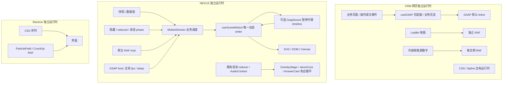
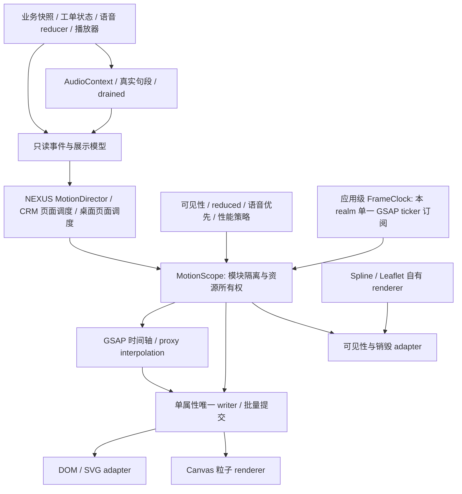

# GSAP 统一编排架构建议（待架构审核，未实施）

建议将 GSAP 确立为平台主要**视觉编排**技术，保留 CSS 的轻量交互、SVG 的地图与几何、Canvas 的粒子渲染、第三方 3D/地图运行时和现有业务状态机。动机是减少重复编排和生命周期代码；本轮没有证据证明“换 GSAP 即可使4K变快”。

## 现状



三仓库、不同JS realm不可能共享同一个ticker。统一的是接口、策略与可复用包；每个应用/窗口仅持有本realm自己的根时钟，不建跨进程全局钟。

## 建议职责



| 层 | 拥有的内容 | 不应拥有的内容 |
| --- | --- | --- |
| 业务层 | 指标口径、权限、服务端刷新、语音reducer、音频状态 | GSAP时间轴、逐帧DOM属性 |
| MotionDirector | INTRO/AMBIENT/PULSE/DEGRADED、150秒共振节奏、语音接管、选择与预算8 | 地图投影、Canvas像素细节、全局ticker sleep/fps |
| 应用FrameClock | 注册/释放本应用帧订阅、单调时刻、诊断计数、应用级策略 | 任意子模块自行全局停钟、业务超时 |
| MotionScope | 本模块start/pause/resume/cancel/dispose、timeline/context/listener资源清单 | 暂停其他模块、修改全局defaults或globalTimeline.timeScale |
| GSAP scene | 入场/退场/共振/数字插值，timeline labels及取消策略 | 决定金额/库存、音频播完、权限结果 |
| render adapter | SVG attrs / DOM text / Canvas绘制批次，已验证布局 | 重建业务状态机或改变数据范围 |
| QualityController | 观测质量窗口、驻留/恢复探测/失败退避及日志 | 默默删除视觉效果、让低档成为满档验收 |

## 接口草案与执行约定

以下只是设计，不是新增产品代码：

```ts
interface MotionScope {
  start(cue: Cue, at?: AnimationInstant): CueHandle;
  pause(reason: 'hidden' | 'voice' | 'user'): void;
  resume(reason: 'hidden' | 'voice' | 'user'): void;
  cancel(handle: CueHandle, policy: 'settle' | 'revert'): void;
  setReducedMotion(reduced: boolean): void;
  dispose(): void;
}
interface FrameClock {
  subscribe(scopeId: string, render: (sample: FrameSample) => void): () => void;
}
```

- 一个属性只有一个运行时writer。React只负责结构、业务最终值和初始基线；GSAP可选“直接写DOM”或“采样proxy后由adapter写DOM”，同一属性不得两者并用。现有NEXUS继续proxy + shared writer，先不改成到处gsap.to(selector)。
- CSS hover/color、focus样式保留；如果transform已被GSAP接管，采用内外wrapper分层。NEXUS reset transition属于现有交接协议，迁移必须选择CSS交接或GSAP退场其中一种，不能叠加。
- 一个视觉序列只选自播放timeline或手动seek模式。NEXUS可继续由Director seek detached timelines；不要同时.play()和.totalTime()。
- **ticker所有权在应用入口**。模块只移除自己的callback/暂停自己的timeline。禁止组件调用ticker.sleep/wake/fps/lagSmoothing、globalTimeline.pause/timeScale、killAll。PoC的全局sleep/fps须在共享前替换；不要简单增加引用计数后继续随意sleep整个ticker，因为自动播放的UI tween也可能活跃。
- 不强求所有第三方内部RAF归零。自有Canvas renderer可以接FrameClock，不改成每粒子GSAP tween。Leaflet/Spline保持renderer自治，通过adapter接可见性与销毁；接管其内部时钟前需API与运行验证。
- pause原因是集合：voice退出不能覆盖hidden暂停；只有所有暂停原因撤销才恢复。reduced使用明确最终静止状态，不把语音结束、业务期限一起冻结。
- 页面卸载：取消本scope cue → settle/revert指定属性 → remove本scope帧订阅 → context.revert / kill detached timeline → 取消timer/observer/listener → 清理引用。dispose必须幂等；React StrictMode、快速进出和依赖更新要覆盖。
- 统一包先在各仓库adapter保持API一致；三个仓库未处于monorepo，不在本轮强行抽共享npm包。待两个以上真实消费者验证后再提取版本化包，GSAP作为peer并确保同realm单实例。

## 时间边界

| 时间 | 来源 / 语义 | 和GSAP关系 |
| --- | --- | --- |
| 业务时间 | 快照generatedAt、服务器Date.now、刷新60秒 | 不受动画pause/timeScale影响；不混算为performance.now |
| 动画帧时刻 | performance.now单调时钟；scope映射为“可见且允许动画的累计时间” | 传给Director；GSAP seek做ms→s转换；隐藏后不补跑150秒事件队列 |
| GSAP ticker time | 库自身秒表，可能受lag smoothing影响 | 不直接作为业务deadline或音频时钟 |
| 音频时间 | AudioContext.currentTime、真实PCM句段/EOF/drained | 保持播放器所有权；向视图发只读事件，不能用timeline完成替代 |
| 语音session事件时间 | 既有注入performance.now域及服务端protocol时间 | 保留原reducer语义与跨域映射；不以统一动画推翻 |

现有Legacy host.now=performance.now、GSAP host.now=0，Director.start又把introEnd设为绝对2200；统一时钟时应明确起点为0/记录start epoch，补长加载后的入场测试。它是潜在时基差异，不作为本轮4K主因。

GSAP官方说明ticker是共享更新心跳，fps/lagSmoothing改变全局动画时间行为；React useGSAP/context提供作用域清理。以上应用分层与时钟隔离是结合本项目的设计建议，并非库自动保证：[ticker文档](https://gsap.com/docs/v3/GSAP/gsap.ticker/)、[React指南](https://gsap.com/resources/React/)、[context清理](https://gsap.com/docs/v3/GSAP/gsap.context()/)、[Timeline](https://gsap.com/docs/v3/GSAP/Timeline/)。

## 分阶段迁移与回退

| 阶段 | 模块 | 收益 / 风险 | 前置依赖 | 回归 | 回退 |
| --- | --- | --- | --- | --- | --- |
| 0 | 后端明确的4K基准、quality最小补丁；绘制PoC按硬件结果决定，仍Legacy默认 | 先解决观测问题；不把库迁移当性能方案 | 本轮诊断、架构审核 | 四组对照、满档和自适应分开、视觉逐像素/人审 | 单独提交可撤销，保留原视觉资源 |
| 1 | CRM小川转场清理、通用MotionScope与ticker边界 | 收敛生命周期；风险为取消后基线变化 | scope协议、显式property owner | 快速切换、reduced动态切换、StrictMode；其他动画同时活跃 | 旧wrapper/feature flag |
| 2 | NEXUS已PoC入场/共振/数字插值 | 编排集中；风险是reset/时间域/预算8 | 4K优化独立通过，FrameClock就绪 | 复用606单测、134浏览器用例；共振/语音抢占/数据更新/静态SSR | `motion=legacy`，Legacy继续可构建可测 |
| 3 | 桌面CountUp、CRM嵌入屏数字、需要协调的CSS序列 | 消除重复tween逻辑；风险每帧React churn与数字显示 | 两消费者接口验证 | 中途换目标、负数/异常、reduced、卸载与数值最终一致 | 分模块恢复RAF，不改业务API |
| 4 | 答案卡展开/折叠、Overlay几何 | 可读时间轴；语音回归风险高 | 主屏迁移稳定、保留语音demo回退 | 真实音频/打断/句段/翻页/隐藏、物理麦克风扬声器验收 | 保留原卡片视觉驱动，reducer/player不动 |
| 5 | Canvas接统一帧订阅；Leaflet/Spline可见性adapter | 管理资源；底层渲染继续保留 | renderer性能与第三方生命周期证据 | 4K、切页、后台、长运行、真实设备 | 恢复各renderer局部循环 |

每阶段独立PR/提交、单独架构确认；本轮不实施。简单hover、focus、loading spinner、SVG投影、Canvas逐像素、WebGL内核、业务刷新/打印/音频计时不列为GSAP强制迁移对象。
