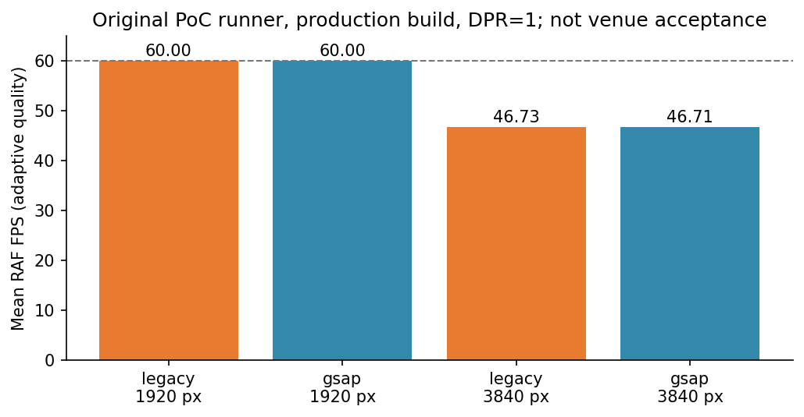
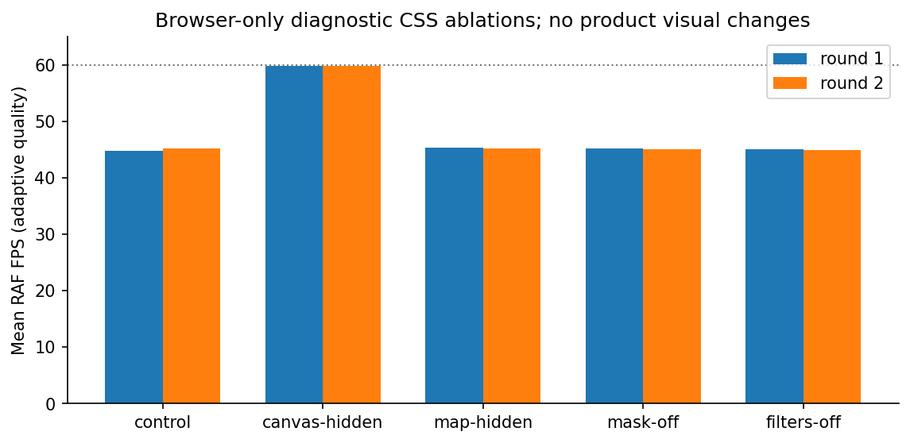
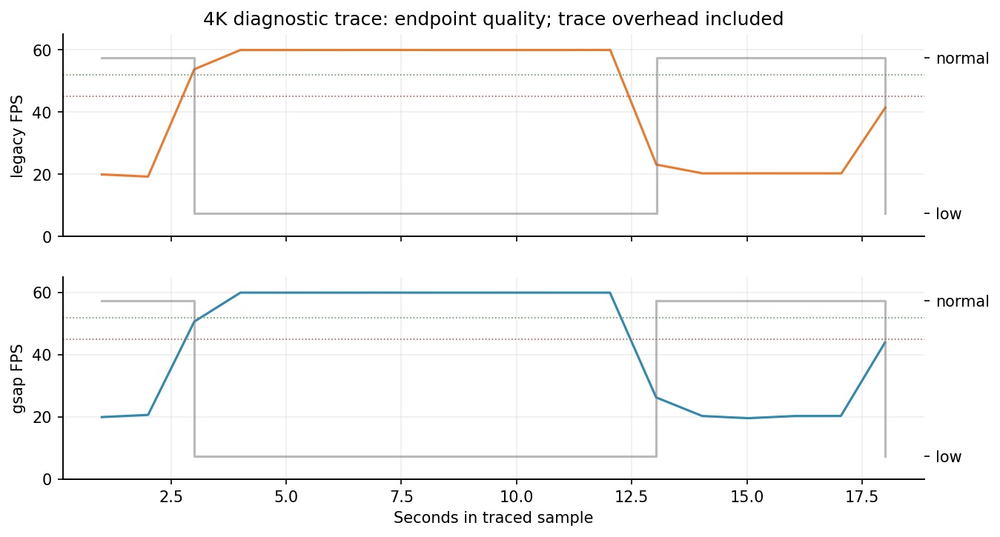

# NEXUS 4K 性能诊断

本轮产品源代码保持 `1f9e9cd`。复用原PoC生产构建与原基准脚本，四组顺序执行；结论适用于本机headless环境，不能替代展厅验收。Trace和逐项对照是另行采集的诊断，不与长样本混算。

## 原基准复现

机器：Apple M1 Ultra，20核，64 GiB；darwin 24.6.0 arm64；Node v24.21.0；Chromium 153.0.8010.12。

统一夹具：本地3199；DPR=1，seed=713，reduced=no-preference，layout=16x9，真实时间；仅generatedAt每轮重置。业务归一化SHA-256四组相同：`8f733819a5fcfcb49bf964e8e9dec9f43163de471a7f32e88d768ecd773cafd9`，与原PoC相同。每轮60秒原业务刷新保持开启。没有在计时阶段录屏、跑构建或并行测试。

| 分辨率 | 引擎 | 实测秒 | RAF FPS | P95/P99间隔ms | 丢帧估算 | callback P95 ms | 长任务 | 降档/恢复 |
| --- | --- | --- | --- | --- | --- | --- | --- | --- |
| 1920×1080 | legacy | 120.04 | 60.00 | 16.7/16.8 | 0.00% | 0.30 | 0 | 0/0 |
| 1920×1080 | gsap | 120.05 | 60.00 | 16.8/16.8 | 0.00% | 0.30 | 0 | 0/0 |
| 3840×2160 | legacy | 300.08 | 46.73 | 50.0/50.1 | 22.12% | 0.20 | 0 | 20/19 |
| 3840×2160 | gsap | 300.10 | 46.71 | 50.0/50.1 | 22.15% | 0.20 | 0 | 20/19 |

原PoC的4K为47.09/46.82 FPS；本轮46.73/46.71 FPS。差值不足以证明某引擎快或慢。两次实验共同复现的是正常/低档交替，平均FPS掩盖了它。全部主屏采样无页面脚本异常；网络记录包括后续软导航的RSC取消请求，详见原始JSON，不能把取消请求当主屏崩溃。

主线程CDP累计指标：

| 场景 | Task s | Script s | Layout s | RecalcStyle s |
| --- | --- | --- | --- | --- |
| legacy 1920 | 14.294 | 1.890 | 0.270 | 2.368 |
| gsap 1920 | 14.671 | 1.975 | 0.284 | 2.399 |
| legacy 3840 | 19.703 | 3.395 | 0.545 | 2.587 |
| gsap 3840 | 19.731 | 3.503 | 0.512 | 2.453 |

这些是渲染器主线程累计秒数，不是整机CPU占比；callback只覆盖包裹的RAF回调，不包含完整绘制/栅格/合成。FPS与丢帧均由RAF间隔估算，不是GPU真实presentation统计。主屏用例max pending RAF=1；该算法不能直接用于语音等多RAF并发页面（应按唯一timestamp分开计帧，不能将所有callback都当一帧）。

## 升降档规则与因果链

实际代码：`src/components/screen/motion/config.ts:11–12` 与 `MotionDirector.ts:84–98`。1秒FPS窗口；连续低于45累计5秒降low；连续达到52累计10秒从low恢复normal。45→52已经有7 FPS阈值间隔，5/10秒也有持续性判断。**不能说现有策略完全没有滞回。** 但没有独立的最低驻留设置、恢复探测态、恢复失败记忆或退避。

在当前代码中，low会隐藏全屏粒子Canvas（normal且预算允许才显示），光流由至多2条缩到1条，共振只允许normal。低档的轻负载60 FPS被用于判断高档承载力，恢复后原负载再次出现；降档/恢复都清空累计窗口，重复同一闭环。没有证据表明换GSAP能改变共享绘制出口。

本轮两个4K长样本各20次降档、19次恢复；Legacy的低帧触发窗口约20.66 FPS，恢复窗口约60 FPS。相邻日志显示低档约10.1秒、正常档约5.1秒；约15.2秒一循环与源码判断窗口吻合。共有的持续性能负载和恢复策略共同形成反馈；不能仅用平均46.7 FPS描述“略有掉帧”。

实际low驻留至少需要10秒连续恢复窗口，但没有独立于恢复判定的驻留/失败退避。候选改法是先修绘制热点，再加入可观测的驻留、满档probe及失败退避；阈值或候选秒数不能未经对照直接上线，详见施工清单。
## 浏览器后端与分辨率语义

本轮 `SystemInfo.getInfo` 实际返回：`ANGLE (Google, Vulkan 1.3.0 (SwiftShader Device ...))`，driverVendor `SwANGLE`；`2d_canvas=unavailable_software`、`gpu_compositing=disabled_software`、`rasterization=disabled_software`。启动进程为 Chromium **headless shell**，不是已经确认使用M1 GPU的有头浏览器。系统显示硬件为Apple M1 Ultra、48核GPU；“机器有GPU”不等于“本次浏览器使用该GPU”。

`Browser.getBrowserCommandLine` 因未启用enable-automation被拒绝，原始错误已保存；未为了采参改变启动条件，改由SystemInfo浏览器PID读取本次测试进程参数。没有采集机器序列号/UUID。

这解释了为什么不能把原平均FPS当作展厅显卡能力。GPU状态是本轮同默认launch环境的实测；原PoC历史报告没有GPU状态，不能追溯断言其当时后端，只能指出使用相同脚本/浏览器的本轮复现具有该限制。

DOM实测：16:9舞台逻辑1920×1080，在4K viewport中fit transform scale=2；粒子Canvas backing仍为1920×1080，显示边界为3840×2160。不是每帧在一个3840×2160的Canvas backing上绘制150粒子。增加的是最终显示/合成面积和相关渲染路径，不能仅按粒子个数解释成本。

地图为451个SVG path、16个SVG元素（包括卡片图标等），三层SVG地理底图、椭圆CSS mask、静态DOM标签。`ShipmentMap`投影/标签在React render时计算，路径点在scene effect初始化采样101点/route，未发现每个动画帧重新投影全部省界。旧layer-2 drop-shadow被后置CSS `filter:none`覆盖，不能当作当前地图热点。实际卡片/图标仍有drop-shadow，已记录computed style，不概括为“没有任何filter”。

CDP层树在软件路径仍报告Canvas图层，原因文案是“accelerated canvas **or display-list backed canvas promoted by heuristic**”；这不是硬件加速已开启的证据。具体后端应以SystemInfo featureStatus与Trace结合判断。图层边界、paintCount、合成原因是可复查的拓扑证据，不能换算为可靠显存占用。

## 绘制路径逐项对照

一次性页面CSS覆盖，正序和逆序各一轮，每项24秒；保持相同业务夹具/seed/DPR/原自适应策略。它们是诊断对照，关闭页面即消失，不是产品视觉修改。

| 浏览器内临时对照 | 第一轮 RAF FPS | 逆序第二轮 RAF FPS | P95间隔 | 观察 |
| --- | --- | --- | --- | --- |
| control | 44.86 | 45.21 | 50.0/50.0 ms | 仍正常/低档交替 |
| canvas-hidden | 59.87 | 59.83 | 16.7/16.7 ms | 保持normal；JS原绘制调用仍执行，只取消可见Canvas合成 |
| map-hidden | 45.36 | 45.15 | 50.0/50.0 ms | 仍升降档；不支持先删地图 |
| mask-off | 45.21 | 45.07 | 50.0/50.0 ms | 仍升降档；不支持取消遮罩 |
| filters-off | 45.07 | 44.95 | 50.0/50.0 ms | 仍升降档；不支持删滤镜视觉层次 |

24秒对照的初始强制normal与观察窗口占比，和原300秒样本不同，所以44.9不能与46.7直接算优化百分比。两轮各case内部可以比较；样本仍不足以作统计显著性声明。

Canvas-hidden仍执行原150粒子更新、clearRect/fillRect和DOM编排，主线程Script累计并未因删掉计算而明显降低（更高回调频率反而增加总计算）。恢复到接近60 FPS且不再降档，结合SoftwareRenderer Trace，支持**软件后端的动态Canvas可见合成路径**为主要负担。它不等同“150次fillRect数学太慢”，也未定位为物理GPU显存/带宽耗尽。

现有CDP已报告Canvas独立图层，不能未经对照就把添加will-change/多图层当默认修复。候选无视觉损失技术只应在软件回退需求或实际GPU仍失败时试验；保持粒子、地图光流、电影式入场、标签和交互，先测局部更新/缓存/合成策略，再作架构决策。

## 完整Trace热点与线程归因

最终软件后端1080p各12秒、4K各18秒；有头Metal的4K各12秒。4K补采与有头Trace的dataLossOccurred均为false，实际事件覆盖约18.00/12.02秒。首轮36秒请求只有约23秒事件覆盖，原文件及说明保留于 `.review/p1-4/trace-initial-buffer-limited/`，没有将其作为完整36秒数据。

下表为事件每次平均inclusive CPU/线程墙钟耗时（ms），不能将嵌套事件相加成CPU百分比；Paint与RAF事件次数不同。normal/low按Trace内user timing等级标记划分，切换边界可包含一帧旧负载。

| 环境/引擎/等级 | RAF事件均值 | Style均值 | Layout均值 | Paint事件均值 | Display DrawAndSwap均值/最大 |
| --- | --- | --- | --- | --- | --- |
| 软件 Legacy normal | 0.439 | 0.193 | 0.058 | 0.199 | 47.437 / 53.707 |
| 软件 Legacy low | 0.335 | 0.180 | 0.052 | 0.188 | 2.603 / 49.214 |
| 软件 GSAP normal | 0.476 | 0.196 | 0.058 | 0.198 | 47.329 / 53.637 |
| 软件 GSAP low | 0.364 | 0.178 | 0.053 | 0.187 | 2.591 / 48.084 |
| Metal Legacy normal | 0.498 | 0.238 | 0.074 | 0.282 | 0.107 / 0.363 |
| Metal GSAP normal | 0.298 | 0.213 | 0.063 | 0.236 | 0.062 / 0.137 |

软件路径的DirectRenderer::DrawFrame内部可见SoftwareRenderer::DoDrawQuad；正常档Display绘制约47ms，超出60Hz约16.7ms预算，降low后约2.6ms。主线程RAF平均约0.3–0.5ms，Style约0.2ms、Layout约0.06ms。正常档RasterTask平均约0.78ms、最大约5.4ms；多worker累计不等于主线程停顿。单纯减少GSAP插值数学或微调布局，不能解释或抵消这条约47ms软件合成路径。

软件后端CrGpuMain主要是SharedImage创建/销毁请求（18秒内RunTask累计约16ms），不能据“有GPU进程”认为在使用物理GPU。Metal Trace可见GPUTask/CommandBuffer::Flush：12秒内CrGpuMain GPUTask累计约2.42秒（Legacy）/1.14秒（GSAP），但场景更新率本来不同；这些是GPU进程线程事件，不是硬件GPU内核占用或纯GPU渲染时长。Metal的Display CPU提交很短，不能将47ms与0.06ms直接换算为显卡加速倍数。

所有Paint node、失效事件、线程统计、层树与DOM/backend node映射在原始JSON中。Canvas拓扑约5–9层的观察含stream导出后的活动，仅用来说明实际已分层，不将它作为采样窗口内精确层数时间序列。工具没有可靠给出物理显存、GPU带宽、真正presentation/drop事件或LED刷新；这些保持未定位，不猜测“显存不足”。

## 有头Metal补充复核与采样器边界

同版本Chromium完整浏览器、headless=false，CDP确认ANGLE Metal Renderer: Apple M1 Ultra；Canvas、GPU合成、rasterization均enabled。系统参考显示器是27E2N1110，1920×1080 @100Hz；测试用CDP viewport覆盖1920×1080和3840×2160，DPR=1，4K stage显示边界实测3840×2160。物理屏幕并非4K，浏览器外窗会受OS尺寸约束，所以这是硬件后端的虚拟viewport能力复核，不是4K LED现场present验收。

每组60秒、不录屏，30秒请求一次共振；四组均观测AMBIENT与PULSE且全程normal，无降档。另取12秒有头4K ambient Trace；它不覆盖共振峰值的完整GPU trace。

| 场景 | 60秒底层RAF FPS | RAF P95 ms | 12秒补充Director实际窗口FPS均值 | 档位 |
| --- | --- | --- | --- | --- |
| Legacy 1920 | 99.12 | 11.0 | 100.00 | 全程normal |
| GSAP 1920 | 100.00 | 11.0 | 59.97 | 全程normal |
| Legacy 3840 | 100.01 | 11.0 | 100.02 | 全程normal |
| GSAP 3840 | 99.99 | 11.0 | 60.00 | 全程normal |

原collector测的是底层RAF调度，并不总等于画面更新率。GSAP ticker可以在100Hz显示器上仍每次请求RAF，但内部按fps(60)跳过部分scene更新；Legacy直接跟随约100Hz。补充读取MotionDirector原1秒窗口才看见100/60的真实区别。两个引擎“RAF都100”不能证明场景也都100；100对60也不能解释为库性能差，因为策略上限不同。原headless四组为60Hz调度且两引擎有效更新都约60，原矩阵仍可比较；在多RAF或高刷新率环境必须同时记录底层调度与实际writer/Director节奏。

有头和软件后端不仅GPU配置不同，参考调度频率、运行时长也不同，不能把它们合并成一个严格单变量速度提升百分比。但实测Metal后端下同完整视觉路径保持正常档，足以否定“原47FPS已经证明M1 GPU承载不了4K”或“GSAP计算导致4K慢”的结论。

## 架构结论与下一轮边界

- 当前可复现问题的主瓶颈：默认headless shell的软件显示合成，动态全屏Canvas参与时normal绘制约47ms；证据来自featureStatus、SoftwareRenderer线程、两轮CSS对照及完整等级标记Trace。不是已证实的GSAP插值瓶颈。
- 升降档振荡：低档轻负载达到恢复阈值后直接恢复完整负载，缺少probe与失败记忆；现有7FPS阈值间隔与5/10秒持续窗口不够避免这个持续负载闭环。先保留视觉，改可观测的恢复策略；不要永久锁低档。
- 不支持的结论：删除地图/遮罩/滤镜能解决当前问题；M1物理显存不足；展厅4K已验收；GSAP必然比Legacy快。
- 最小下一步：测试工具显式核验GPU/刷新率/实际更新节奏；quality驻留、probe及失败退避；共享前隔离ticker所有权并补Chat转场清理。仅在需支持软件回退或实际硬件长测仍失败时做保持视觉的Canvas/合成PoC。
- 待验证：真实4K/LED输出、真实DPR与刷新率、两引擎同目标更新率下的重复长样本、共振峰值GPU trace、全天运行、语音物理链路。本轮没有推送、合并、部署或启动Task11。

原始文件位置、重建步骤与限制见[复查说明](REPRODUCE.md)，精简可审计数据及哈希见[evidence](evidence/artifact-manifest.json)。
