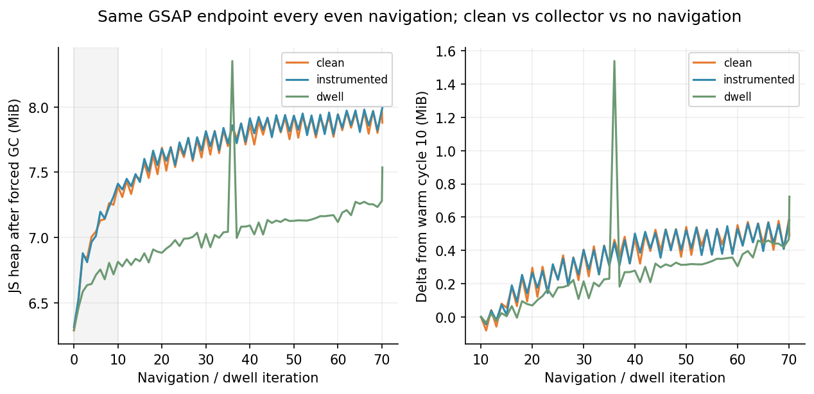

# 软导航内存诊断

本轮不以“堆增长”等同泄漏，也不以“about:blank后能释放”证明软导航安全。原PoC10次切换的增长被保留作为历史问题；本轮主要依据预热后70次同文档客户端导航、驻留对照、堆对象ID和强保留路径。

## 实验设计与指标边界

- 同一生产构建、fixture、seed=713、DPR=1、1080p；独立浏览器上下文，GSAP/Legacy每2.5秒交替切换。偶数导航回到同一GSAP端点；10次为预热，随后10→30、30→50、50→70三批各20次。
- 每次采样前两次强制GC；最后同页再驻留15秒。性能Trace/基准不与GC和堆快照混跑。这里的GC堆用于保留分析，不能当自然GC条件下的RSS预算。
- `clean`：没有RAF采样数组和PerformanceObserver，只固定随机种子；**仍受Playwright/CDP连接影响**。
- `instrumented`：原PoC collector，每次GC前清空其数组，排查collector本身的影响。
- `dwell`：不导航，重复等时长等待与相似协议读取，观察运行时、60秒数据刷新和工具预热。
- 干净组在10/30/50/70和settled取快照；驻留组也取settled快照。全程不离开当前document来“清空证明”。
- Runtime.usedSize是JS堆；HeapSnapshot的shallow self bytes包含代码、native Blink对象等，不能直接与Runtime.usedSize相减。没有测量浏览器RSS或GPU显存。未计算dominator retained size。

## 预热后GC趋势

| 组别 | 初始 MiB | 预热10 MiB | 30 MiB | 50 MiB | 70 MiB | 同页再驻留15秒 MiB |
| --- | --- | --- | --- | --- | --- | --- |
| clean | 6.286 | 7.391 | 7.796 | 7.932 | 7.976 | 7.879 |
| instrumented | 6.314 | 7.412 | 7.814 | 7.933 | 7.979 | 7.993 |
| dwell | 6.291 | 6.813 | 7.027 | 7.127 | 7.279 | 7.536 |

这里的10次预热是导航路径预热，未覆盖全部飞行/共振分支。驻留组按代码可运行到150秒自动共振及60秒刷新，导航组每2.5秒重挂载会重置Director时钟；本轮未逐窗保存内存组的动效状态。因此驻留组用于证明无导航也会增长，不能当成完全相同动效工作负载后直接相减。

干净组预热后的三批20次增量依次约+0.405、+0.136、+0.044 MiB；再同页驻留15秒回落约0.097 MiB。采样器组与干净组趋势接近；不导航组也有明显预热增长，后段总体趋缓，但仍有刷新/编译波动。不能仅看“70次比10次多”就认定线性泄漏，也不能说已证明永久平台期。

干净组同一GSAP端点DOM节点1196、监听器379，active stage/Canvas/debug均为1；legacy中间端点可多1节点，未逐次累积。原collector没有单独造成导航增长；即便clean组仍存在CDP/DevTools的原生保留，见下文路径。

## 对象保留路径与实例身份

压缩后构造名会变，例如本构建Director为`i`、Scene为`nq`；只按字符串“Timeline”搜索会漏报。分析脚本按自有属性签名识别：Director的frame/callbacks/records，Scene的introTl/pulseTl/routeTls，timeline的labels/vars，tween的_targets/vars；并结合运行时公开audit计数交叉检查。

干净组五份快照均只有1个Director、1个Scene、28个timeline形态对象、56个tween形态对象。运行时Scene audit为1场景/27场景timeline/rootAnimations=0；完整堆还包含共享运行时对象，所以两者不是同一个统计口径。

更强的证据是**对象身份**：第10次快照的Director/Scene，到第30、50、70次及settled均已不在堆中；当时的28个timeline仅1个跨批存活，56个tween仅1个跨批存活。旧场景对应的27个timeline、55个tween未跨后续导航保留。它验证了本组软导航期间的真实GC回收，不只看dispose递减计数，也没有借助离开页面。

当前Scene的强路径为：活跃DOM/React fiber → MotionDebug pendingProps.director → callbacks Map → scene draw closure → GsapScene。当前Director由活跃React状态/props持有。这是当前页面应有的关系；没有观察到历次卸载Scene的链表/数组累积。最短路径常经过工具的当前document/style句柄，它不表示工具是唯一保留者，更不表示所有经过该根的对象都是工具泄漏。

## 已定位的增长构成

从第10次到settled，主要增长类的浅大小包括：InstructionStream约315KB、TrustedByteArray约101KB、ProtectedFixedArray约48KB、Code约16KB；这些是运行时代码/字节码相关对象，不能算成动画实例增长。当前RAF闭包和模块函数持有的优化代码可在强路径中定位。这个分类支持预热解释，但不足以独立证明所有缓存永久有界。

| 实际对象 / 路径证据 | 本轮观察 | 解释与边界 |
| --- | --- | --- |
| HTMLDocument → StyleEngine → StyleResolver → CachedMatchedProperties → ComputedStyle数据 | 样式数据有增长；例如StyleBoxData浅大小约+33KB、SurroundData约+25KB | 明确属于Blink匹配样式缓存；不能凭此声明无限期有界，仍需更长序列 |
| Window → Navigation → NavigationHistoryEntry | native条目12→32→51→51（10/30/50/70） | 后两批出现平台期，非70份动画树；数字是实测对象数，不宣称API上限规范 |
| Performance → LayoutShift entry buffer | 87→150→150→150 | 观察到缓冲条目平台期；与路由切换布局记录有关，非DOM树残留 |
| Performance → PerformanceResourceTiming | 25→45→65→85 | 每次RSC导航新增资源计时条目；本组尚未观察到其平台期 |
| DevToolsSession → InspectorNetworkAgent → NetworkResourcesData → ResourceData | 27→47→67→87；新增60个浅大小约17KB | **明确的采集工具网络资源保留路径**，不能归责为产品GSAP泄漏；也不能假设这个buffer永远不增长 |
| React fiber / TURBOPACK module cache → 当前函数/优化代码 | 代码类增长占主要类别；旧Scene不在其中 | 有合理运行时预热/模块缓存成分；未看到持续叠加的历史动画实例；未证明所有React/路由资源均无长时风险 |

上述是类型与路径分类，浅大小不能相加后当作“泄漏总量”，也不能把native表格与JS heap曲线直接一一对应。完整对象ID、路径与跨批比较在 `heap-analysis.json`，原始快照在 `.review/p1-4/`。

## 结论边界与后续调查条件

已证实本组70次软导航旧场景及对应动画对象能够在**同一document内**被回收；未发现GSAP场景/timeline持续累积。已定位运行时代码、Blink缓存、浏览器Performance/History条目和DevTools网络保留，排除了“所有增长都属于GSAP”的解释。

仍不能据此宣称平台完全无内存泄漏。范围只覆盖固定夹具、两引擎切换、数分钟和本构建；不覆盖真实业务多路由、长期语音、Spline、Electron、浏览器RSS或显存。若需全天展厅预算，建议下一轮500次以上导航、30分钟同页驻留、真实硬件长运行；加入不保留DevTools网络资源的对照，确认资源计时/样式缓存最终平台期，并对任何继续线性增长的对象类追踪dominator与强保留路径。不要为了让指标变平而清理正常浏览器历史或删除视觉效果。
