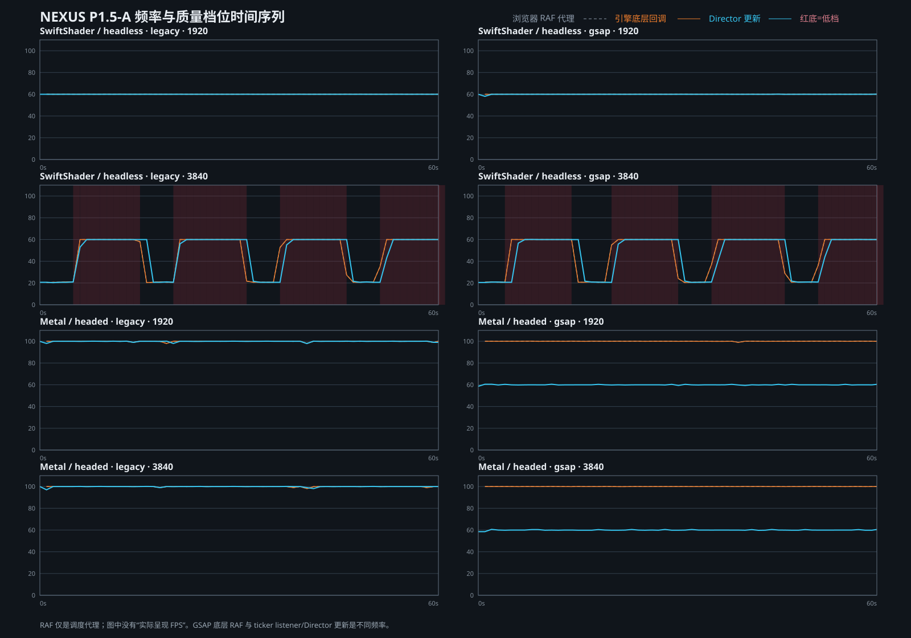

# 频率与质量档位时间序列

## 观测字段

每个点包含：采样时间、当前档位、场景状态、浏览器 RAF 代理、引擎底层回调、底层回调 P95、Director 更新频率、该窗口长任务及当前性能记录。完整 8 组原始点见 [time-series.json](evidence/time-series.json)。

质量规则只读记录为：Director 内部 1 秒窗口低于 45Hz，累计 5 秒降档；达到或超过 52Hz，累计 10 秒恢复。时间序列每秒读取一次，因此图上的切换时间精度约 ±1 秒。

## 档位曲线

- SwiftShader 1080p：Legacy/GSAP 全程正常档，无升降档。
- SwiftShader 4K：两者均 4 次降档、3 次恢复；最后停留低档。正常档更新约 20–21Hz，低档约 60Hz，形成重复振荡。
- Metal 1080p/4K：四组全程正常档；Legacy Director 约 100Hz，GSAP Director 约 60Hz。

## 共振观测

每组在约 10s、30s、50s 发出相同请求。Metal 与 SwiftShader 1080p 均在正常档接受。SwiftShader 4K 中：

- Legacy 有 2 次请求在低档被拒绝；另 1 次在正常档满足接受条件，但随后质量降档可终止 PULSE。
- GSAP 有 1 次请求在低档被拒绝；其余请求按正常档前置条件接受，其中后续降档同样可能终止 PULSE。

这里的“因低档拒绝”按请求瞬间的实际档位和未改动的 `triggerPulse` 前置条件记录，不把下一秒 DOM 状态倒推为同步返回值。

平均频率会掩盖这种正常/低档往返，因此 P1.5-B 不能只用平均 FPS 决定阈值或恢复策略。
