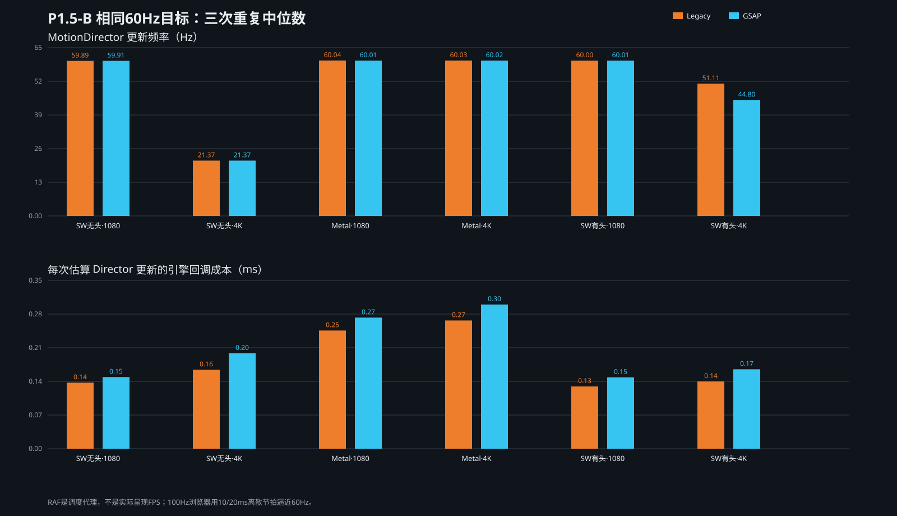

# Legacy / GSAP 相同目标更新率对照

每组独立重复 3 次。表中使用中位数与 IQR；“每更新回调成本”是引擎回调总耗时除以估算 Director 更新次数，包含适配器/ticker 开销，不是纯业务函数的 CPU profile。Task/Script 是约 9 秒正式窗口的 CDP 累计值。

## 相同 60Hz 目标

| 后端 | 分辨率 | 引擎 | Director Hz，中位数 [IQR] | 每更新回调 ms | 间隔 P95 ms | Task s | Script s |
| --- | --- | --- | ---: | ---: | ---: | ---: | ---: |
| 无头 SwiftShader | 1080p | Legacy | 59.89 [0.11] | 0.14 [0.01] | 16.70 [0.10] | 1.10 [0.01] | 0.12 [0.01] |
| 无头 SwiftShader | 1080p | GSAP | 59.91 [0.10] | 0.15 [0.02] | 16.70 [0.00] | 1.10 [0.00] | 0.13 [0.01] |
| 无头 SwiftShader | 4K | Legacy | 21.37 [0.13] | 0.16 [0.00] | 50.10 [0.00] | 0.47 [0.01] | 0.08 [0.00] |
| 无头 SwiftShader | 4K | GSAP | 21.37 [0.28] | 0.20 [0.01] | 50.10 [0.00] | 0.49 [0.01] | 0.08 [0.00] |
| 有头 Metal | 1080p | Legacy | 60.04 [0.09] | 0.25 [0.01] | 21.90 [0.10] | 1.35 [0.04] | 0.21 [0.01] |
| 有头 Metal | 1080p | GSAP | 60.01 [0.07] | 0.27 [0.02] | 21.90 [0.00] | 1.38 [0.04] | 0.23 [0.01] |
| 有头 Metal | 4K | Legacy | 60.03 [0.09] | 0.27 [0.02] | 21.90 [0.20] | 1.42 [0.04] | 0.23 [0.01] |
| 有头 Metal | 4K | GSAP | 60.02 [0.17] | 0.30 [0.02] | 21.90 [0.00] | 1.48 [0.04] | 0.25 [0.01] |
| 有头 SwiftShader | 1080p | Legacy | 60.00 [0.06] | 0.13 [0.00] | 21.90 [1.00] | 1.09 [0.03] | 0.12 [0.00] |
| 有头 SwiftShader | 1080p | GSAP | 60.01 [0.09] | 0.15 [0.02] | 20.90 [1.00] | 1.08 [0.08] | 0.13 [0.02] |
| 有头 SwiftShader | 4K | Legacy | 51.11 [0.54] | 0.14 [0.01] | 30.10 [0.00] | 1.82 [0.39] | 0.12 [0.00] |
| 有头 SwiftShader | 4K | GSAP | 44.80 [0.76] | 0.17 [0.01] | 21.00 [1.00] | 1.39 [0.19] | 0.12 [0.01] |

结论：相同目标后，1080p 与 Metal 4K 的两个引擎均能达到约 60Hz；无头 SwiftShader 4K 两者都只有约 21.4Hz，不能把问题归因于 GSAP。GSAP 的每更新回调成本在这些样本中略高，没有测出足以支持全面迁移的性能收益。

100Hz 浏览器用 10/20ms 离散间隔逼近 60Hz，P95 约 21ms 是显示调度量化结果，不代表平均频率只有 50Hz。

## 保留 native 状态

- 有头 Metal：Legacy 1080p/4K 约 100Hz；GSAP 底层 RAF 约 100Hz，但 ticker/Director 仍约 60Hz。
- 有头 SwiftShader 1080p：Legacy 约 98.6Hz；GSAP Director 约 60.0Hz。
- 无头 SwiftShader：调度参考本身约 60Hz，因此 native 与 shared60 基本一致。
- GSAP 无法执行“Director 100Hz”高目标实验，因为产品 PoC 明确调用 `gsap.ticker.fps(60)`。本轮如实报告限制，没有用底层 RAF 约 100Hz 冒充 ticker 实测 100Hz。

## 运行模式混杂补充

同为有头模式时，SwiftShader 4K 提升到 Legacy 约 51Hz、GSAP 约 45Hz，显著好于无头 SwiftShader 的约 21Hz。这证明 P1.5-A 中“软件后端=无头、Metal=有头”存在真实混杂因素。后端、headless 状态和视口必须继续作为独立字段，不得只写“软件 vs 硬件”。

Paint、Composite/Raster 与 GPU Process 的独立 Trace 见后续 Trace 报告；这些采集不混入本表正式计时。
