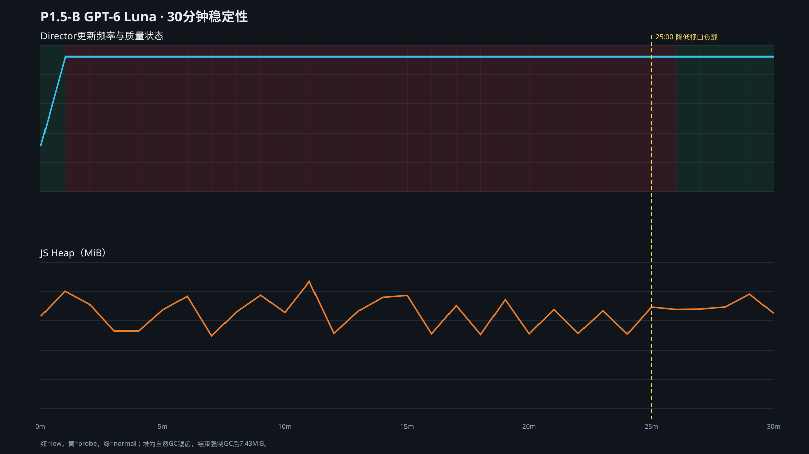

# 30 分钟 SwiftShader 4K 长时间稳定性

执行模型：GPT-6 Luna。场景：无头 Chromium、SwiftShader、Legacy、3840×2160、候选 60Hz 策略。正式时长 `1,800,004ms`。前 25 分钟保持 4K 原负载；25:00.189 将视口切到 1920×1080降低渲染负载，所有视觉模块仍保留。

## 档位切换总数与间隔

| 类型 | 次数 |
| --- | ---: |
| 全部策略状态切换 | 55 |
| 正式 `normal → low` 降档 | 1 |
| `low → probe` 正常负载探测 | 27 |
| `probe → low` 探测失败 | 26 |
| `probe → normal` 正式恢复 | 1 |

- 3.007 秒：严重低频（20.7Hz、P95 50.1ms）触发唯一一次正式降档。
- 首次探测等待 10.043 秒，失败后约 1.009 秒回低档。
- 后续探测等待依次约 20.078 秒、40.146 秒，随后稳定在约 60.19–60.22 秒；失败探测约 1.007–1.010 秒即回退。
- 25:00.189：人为降低负载。
- 25:44.332：按既有退避计划开始下一次探测。
- 25:47.347：连续 3 个窗口通过，正式恢复 normal；距降负载 47.158 秒。
- 恢复后继续运行到 30 分钟结束，没有再次降档。

这 55 次属性变化不能写成 55 次“振荡”：其中 53 次是有明确目的的 probe 开始/失败或成功。完整正式 `normal → low → normal` 只有一次，跨越约 25.7 分钟；旧策略 60 秒内已出现 4 次降档/3 次恢复。

完整逐次记录与间隔数组见 `evidence/long-analysis.json`。

## 内存与计时器

每分钟采集一次，共 31 个资源样本：降负载前 25 个、降负载后 6 个。

| 指标 | 首个样本 | 最后样本 | 范围 | 总体趋势 | 结束强制 GC 后 |
| --- | ---: | ---: | ---: | ---: | ---: |
| JS used heap | 9.26MB | 9.56MB | 7.27–12.75MB | `-3.4KB/分钟`，17 次上升/13 次下降，非单调 | 7.43MB |
| DOM nodes | 1216 | 1227 | 1215–1309 | `-0.13/分钟`，非单调 | 1216 |
| 事件监听器 | 413 | 413 | 378–501 | `-0.35/分钟`，非单调 | 378 |
| active timeout | 0 | 0 | 恒定 0 | 无上涨 | 0 |
| active interval | 3 | 3 | 恒定 3 | 无上涨 | 3 |
| 待执行应用 RAF | 1 | 1 | 恒定 1 | 无上涨 | 1 |

结论：没有观察到内存、DOM、监听器或 active timer 持续上涨。自然堆呈 GC 锯齿，不能用单个峰值定性泄漏；结束强制 GC 后堆回到 7.43MB，DOM 回到 1216。累计 interval callback 数增长是计时器正常执行，不是 active timer 泄漏。

本组为 Legacy，因此 GSAP scene/timeline 计数不适用；GSAP 的实例释放由专项浏览器生命周期回归验证。

## 错误记录

- 页面脚本错误：0。
- HTTP 4xx/5xx：未观察到。
- 记录到 16 次 `net::ERR_ABORTED`，均为同一 sales 路由的取消请求；原始记录保留。它们没有对应页面错误或服务端失败，不能删掉后笼统写“网络记录为空”。
- 测试结束后 3061、3199 端口均已关闭。

## 验收判断

- 严重低频能及时保护：通过。
- 低档流畅不直接恢复：通过。
- 失败探测增加退避并封顶：通过。
- 不形成原策略周期性正式往返：通过。
- 负载改善后自动恢复：通过，47.158 秒。
- 不是永久低档：通过。
- 未通过删减视觉模块换稳定：通过；仅在最后 5 分钟降低视口渲染负载。
