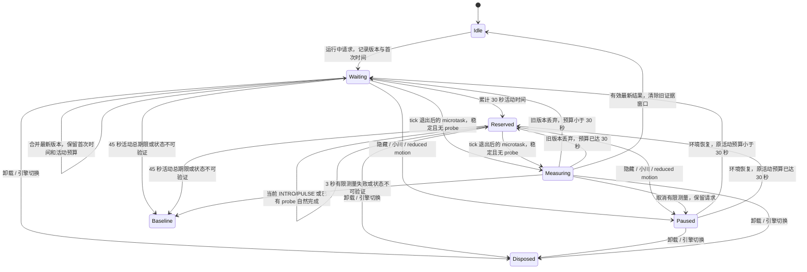

# NEXUS P1.5-C.1：运行中重新校准

基线：`b35b93c230fc6c084895a4119196779f505bf2fb`。本地分支：`codex/nexus-p1-5-c-1-deferred-recalibration`。

本批只改实验模式下运行中重新校准的调度；首次启动的 `calibrateRaf` 路径保持原样。默认 Baseline 不创建延后校准器，不测刷新率，不为 resize 新建计时器。

## 状态与优先级



- resize 的布局处理仍由现有 `ScreenStage` 同步执行，校准队列不参与 fit。
- 可活动时间：组件已启动、页面可见、小川不活跃、非 reduced motion；INTRO/PULSE 和实际测量耗时计入，隐藏/接管/静态期间不计入。
- 30 秒后拒绝新的入场/共振请求，当前 cue 不被队列截断；已有 Candidate/Shadow probe 继续完成。稳定阶段指 AMBIENT 或 DEGRADED。
- 45 秒是队列到最新有效结果的活动总期限：30 秒预留 + 最长 10 秒当前共振 + 最长 3 秒有限采样 + 2 秒调度余量。到期回 Baseline，不强行截断 cue 来完成测量。事件循环阻塞会延迟回调，恢复执行时重新核对实际活动时长。
- 等待阶段只有一个可取消的一次性期限提醒；实际测量复用原有 30 个 RAF 间隔、最长 3 秒的有限采样。不增加长期 RAF、ticker listener 或轮询时钟。
- 实际测量时暂停 Director 的稳定场景时钟，取消它已经预约的下一 tick；不伪造页面隐藏，不调用 `stable()`，不改下一共振时间。有限暂停可在稳定环境中被观察到；本批不承诺校准过程完全无静止帧。
- 预留期间仅禁止开始新的 probe；原降档保护仍持续采样，原质量阈值保持不变。
- 测量中再次 resize 只更新请求版本，不重启当次测量。旧结果不得写入 Director；完成后重新测最新版本，首次时间和活动期限仍不重置。
- 隐藏、小川接管、reduced motion 会取消当次采样和期限提醒，恢复后重试；卸载/引擎切换清理队列、计时器、RAF，旧回调和已排 microtask 无效。
- 应用新参考时清空 Director 窗口与策略证据；测量无效、时钟回退、未知场景、总期限超时、驱动异常均记录原因并回 Baseline。回退后的 resize 不再启动实验校准。

## 修改前证据

原始记录：[baseline/report.json](evidence/baseline/report.json)。视频为同一次连续录制，包含 INTRO resize、PULSE resize 与重复 resize。

| 引擎 | INTRO resize | PULSE resize | 重复 resize |
|---|---|---|---|
| Legacy | INTRO → AMBIENT，立即暂停 | PULSE → AMBIENT，立即暂停 | 40 次事件期间测量被反复重启；此段之前已经回退 Baseline，不能当作纯 Candidate 连续实验 |
| GSAP | INTRO → AMBIENT，立即暂停 | PULSE → AMBIENT，立即暂停 | Candidate 中 40 次事件反复重启有限测量，停止事件后才恢复 |

Legacy 的状态记录显示：INTRO resize 前 `at=3588.6ms`，resize 后 `at=3605.5ms` 已 AMBIENT/paused；PULSE 对应 `7994.3ms → 8010ms`。布局缩放均立即生效。GSAP 记录保留在同一 JSON。没有把“当前已暂停、不断重启测量”夸大成已经观察到无限队列或内存泄漏。

## 验证与交付

最终检查、动态视觉审阅、许可隔离、精确 diff、提交标识及回滚说明见本目录交付报告。所有浏览器使用本地 fixture；视频用于时序和布局审阅，不能替代屏幕呈现时间或展厅设备验收。

开发过程中的失败检查保留在 `evidence/history/`：初始单测按固定时间假设 probe 仍在运行，实际已经失败返回 low，改为等待实际 probe 状态；浏览器测试先后补齐异步 media 恢复事件、JarvisCore 自有 RAF 对照、语音既有的 800ms 收拢与 520ms 淡出。均保留原断言失败及最终修正后的结果，没有修改语音代码或放宽质量阈值。

复现命令（在本工作树）：

```sh
pnpm install --offline --frozen-lockfile
pnpm build
pnpm test
pnpm exec tsc --noEmit
pnpm exec playwright test -c e2e/p1-5-c-1.config.ts
NEXUS_QUALITY_PERMISSION=local-candidate pnpm exec playwright test -c e2e/p1-5-c.config.ts
pnpm exec playwright test -c e2e/p1-5-c-safety.config.ts
GSAP_REGRESSION=1 NEXUS_MOTION_ENGINE=legacy pnpm exec playwright test -c e2e/gsap-poc.config.ts
GSAP_REGRESSION=1 NEXUS_MOTION_ENGINE=gsap pnpm exec playwright test -c e2e/gsap-poc.config.ts
C1_PHASE=fixed C1_WIDTHS=1280,1792,1920,3840 node scripts/p1-5-c-1/capture.mjs
```

不得推送、合并或部署。本批完成后等待架构审核；首次启动校准和生产默认视觉时间轴不在本批范围。
