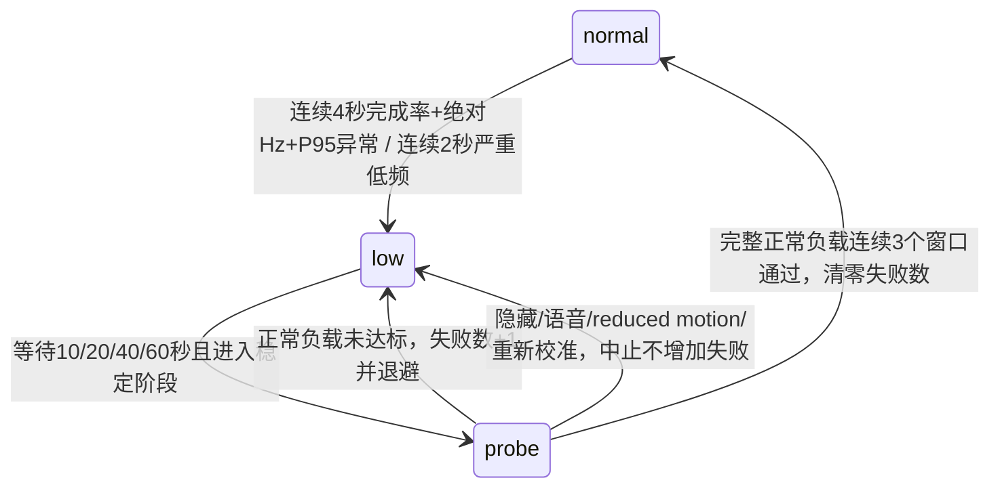

# 接口与控制权

`src/components/screen/motion/QualityPolicy.ts` 是纯 TypeScript 模块，没有 DOM、SVG、Canvas、业务依赖、计时器或上传逻辑。

| 类型 | 内容 |
| --- | --- |
| `QualitySample` | 单调时刻、有效目标 Hz、实际更新 Hz、间隔 P95、窗口起止与更新数、可见性/语音/reduced motion/场景阶段/校准版本、是否完整正常负载 |
| `QualityState` | `normal / low / probe` |
| `QualityDecision` | 新旧状态、明确原因、原始证据窗口、失败数、下次探测时刻、累计低频/严重低频时间、连续通过窗口数 |
| `QualityPolicy` | `sample()` 确定性决策，`interrupt()` 清除中断前证据 |
| `ProbeQualityPolicy` | P1.5-B 参数的正式候选实现，不读取现实时间，所有时间通过样本传入 |

`MotionDirector` 用自己的唯一更新时钟聚合连续完整窗口并调用策略。组件只读取实际档位及切档时间绘制，无法参与降档/恢复判断。没有第二套长期 RAF 或质量计时器。有限 RAF 校准最多 30 个间隔，有 3 秒一次性截止，隐藏/语音/reduced motion/卸载会取消 RAF 与截止计时器。

## 三种模式

| 模式 | 实际质量写入者 | 候选决策 | 手动调试 |
| --- | --- | --- | --- |
| Baseline（默认） | 原 P1.4：<45Hz 连续 5 秒降档；≥52Hz 连续 10 秒恢复 | 不运行 | 只允许本地 `local-candidate` 许可；普通访问在 Director 内拒绝 |
| Shadow | Baseline | 只记录；实际低档样本不能算作全负载恢复通过 | 只允许本地控制许可，不赋予 Shadow 许可控制能力 |
| Candidate | 候选策略，Baseline 写档分支关闭 | 决策直接由 Director 应用 | 即使拥有许可也不能人工改档，避免控制冲突 |

没有 `window` 质量控制器，没有模拟点击质量按钮，没有外部策略接管 API。允许的 debug 事件只有原有语音模拟和无写档权限的重新校准。

## 状态机

有效目标为有限场景 RAF 校准参考与引擎上限中的较小者；Legacy 不新增产品上限，GSAP 保留 60Hz。受控性能测试额外注入共同 60Hz 调度上限，明确属于测试工具。

初始参数保持 P1.5-B：一般降档 `completion<.75 && Hz<45 && P95>1.8×目标间隔` 连续 4 秒；严重保护 `completion<.55 && Hz<30` 连续 2 秒；探测通过 `Hz≥max(52,.9×target) && P95≤1.5×目标间隔`，连续 3 个完整窗口。退避为 10、20、40、60 秒，之后始终 60 秒。没有可通过 URL 修改的阈值。

窗口不足 1 秒、非有限数、窗口更新不足、重叠/过期/断续、校准版本或目标改变都会清除旧证据。暂停不推进采样时钟、不累积低频，不计为探测失败；低档中断保留原探测截止时刻，恢复后若已到期则在新的完整稳定窗口试探；不反复重置整段等待。正在进行的 probe 被中断时也保留已到期的机会，但必须用恢复后的新稳定窗口重新开始，旧通过窗口清零；时钟回退时等待上限仍受 60 秒约束。同一 Director 的失败数保留，成功后清零。更换引擎/模式或卸载结束当前实验实例，新实例重新校准和采样，不把旧引擎的证据带入新引擎。失败等待始终封顶，环境稳定后不会永久放弃探测。

低于 52Hz 的有效参考无法满足保留的绝对恢复阈值：实验明确回退 Baseline，记录 `reference-below-supported-probe-floor`，不擅自调低阈值。Baseline 原先对低刷新率显示器的恢复限制仍在；这类设备不具备本批 Candidate 灰度资格，需要另行架构决策。校准超时/非法校准、策略抛错/非法决策也回退 Baseline，保留当时保护档位，之后由 Baseline 控制。

## 视觉时序与调度边界

探测仅在 AMBIENT 或与其对应的低档 DEGRADED 阶段开始。正在运行的 INTRO/PULSE 不被探测打断；低档继续拒绝共振。探测期间不接收新的共振/重启入场请求。到期后持续被 INTRO 请求推迟超过 30 秒时，Director 拒绝新的入场请求，当前入场仍自然结束（最长 2.2 秒），再使用下一完整窗口开始探测。小川/隐藏/reduced motion 优先级更高，不为探测强行恢复动画；退出后保留既定探测机会，以新的完整稳定窗口重新尝试。

探测切档不调用 `stable()`，不重置 scene time、发货选择、地图航线位置、飞行动画或下次共振时间。初次正常降档仍保留原低档共振取消规则。候选模式使用原 `reset=280ms` 时长渐入/渐出粒子和第二条在途光流，地图、航线、业务数字和发货列表不移除。恢复成功时实际负载早已是 normal，不再重复切换。混合过渡窗口不能计为恢复通过，但若已显示过载，可以立刻作为失败保护证据；通过必须来自三个完整正常负载窗口。

实验启动、resize/orientation 或手动重校准会有限暂停 Director，以隔离场景负担测参考；按照既有暂停规则落到稳定阶段，当前 INTRO/PULSE 不会续播。Baseline 不运行这段校准。此行为与正常质量 probe 分开：probe 不启动校准、不 stop 时钟，只在稳定阶段开始。应在 AMBIENT 操作手动重校准；是否进一步把自动重校准也排队到稳定阶段，留给架构审核。

## GSAP ticker

唯一管理入口：`GsapTickerOwner.ts`。只有它可设置 `gsap.ticker.fps(60)`、注册/移除应用 listener、在确认独占空闲时 sleep。场景组件只能请求受控的 `settleIdle()`；入口会检查自有 listener 为 0、根时间轴没有动画且 ticker 仅剩 GSAP `updateRoot`。检测到其它消费者时不会 sleep。没有组件可全局 wake 或随意修改 fps。

计数在 listener 函数入口递增，包含 GSAP wake 的同步调用，独立于 Director 派发数。`tickerAudit()` 是只读快照，提供实际累计次数、首末时刻、自有 active listener 和 60Hz 上限；窗口频率通过两次计数差 / 实际墙钟间隔计算，不能把 Director FPS 重新标成 ticker 实测。

每个 host 只保留一组单次请求，暂停和卸载移除自己的 listener。同步 wake 不得在 `request()` 返回 ID 前执行 Director 回调；`requesting` 守卫确保 RAF 语义。所有权检查防止场景初始化/更新恰逢 Director 帧内 `id=null` 时误睡眠。

## b3d5c11 后的本地许可安全补强

Host 只作附加过滤，不证明网络来源。实验现在还必须有专用本地启动器创建的请求级网络证明：实际 listener、socket 本地地址与对端地址均为回环，端口与 listener 一致，并且原始请求没有代理/转发或伪造边界头。检查发生于 Next 填充自己的转发默认值之前；随后使用 AsyncLocalStorage 隔离请求，服务端入口只能读取本请求的结果，不靠请求头、URL 或环境变量自证边界。

普通 Next 服务没有安装请求上下文，因此即使设置 local-candidate、伪造 localhost Host 也只能得到 Baseline 且不能手动改档。专用启动器固定监听 127.0.0.1，不接受 hostname 选项；原 local-shadow 的权限不会升级。没有新增外部 API、密钥、遥测或质量控制者。

这一证明限定受控测试服务的 TCP 回环边界，不是用户身份认证。禁止将其通过反向代理、端口转发或隧道暴露；携带已知转发头的请求拒绝实验。任意去掉所有标识的本机中继无法仅靠最终 TCP 连接辨识，不把该机制宣称为这类部署或生产灰度的授权。缺少证明、无法核对边界时安全拒绝。

动画与重校准时序源文件本轮未变。[详细提案与证据](07-safety-boundary.md)。
