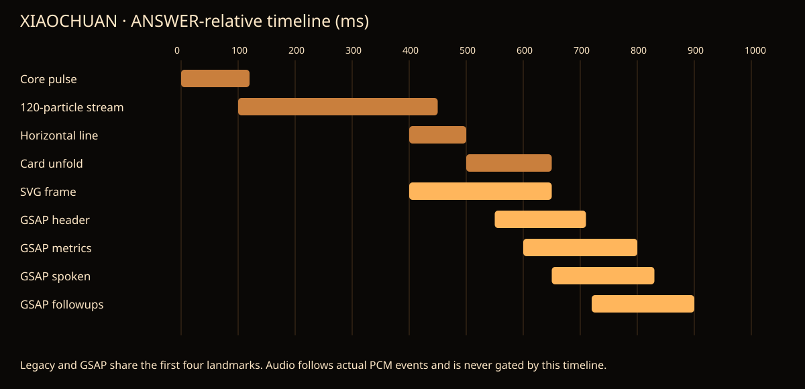

# 小川 GSAP PoC 设计说明

本地分支 `codex/nexus-p1-6-xiaochuan-gsap`，基线 `cf1a835fbbc4e3f62311987e23677ea3fb862125`。

## 开关及回退

正常 `/screen/sales?voiceLive=1` 仍使用 Legacy。显式增加 `xiaochuanMotion=gsap` 才动态加载编排模块；删除该参数并重载即完整回退。该开关独立于主屏 `motion=gsap`，两者可同时使用已有 ticker owner。没有默认启用、推送、合并或部署。

`/poc/xiaochuan` 为组件卸载/导航审核页，只有服务进程显式设置 `XIAOCHUAN_POC_REVIEW=1` 时开放，否则 404。它仅使用仓内合成 fixture，不取生产数据；菜单提供卸载、重新挂载及 Next Link 站内导航。

## 最小层的职责

`XiaochuanTimeline` 只持有数字视觉快照及命名的 paused Timeline。已有 `createGsapHost()` 提供 tick；按 `performance.now()` 绝对时钟 seek，不依赖 GSAP 全局 playhead 的滞后补偿。它不接触 reducer、hub、ASR、TTS 请求、播放队列或业务数据。

命名轨道替换先采样当前姿态并 kill 旧轨道；结束即 kill。隐藏时取消本层 host job，保留暂停轨道，恢复时直接采到当前阶段；不会重播光流。卸载清理 job、全部轨道及订阅。Canvas 自身仍由原 rAF 绘制，并沿用原状态参数平滑、自转、粒子材质和数量预算。GSAP 不绘制粒子。

| 对象 | 写入者 | 其他参与者 |
|---|---|---|
| pulse / stream / unfold / fold / formation / collapse | GSAP 数字轨道 | Canvas、卡片只读快照 |
| Canvas 像素 | JarvisCore 原渲染器 | GSAP 无像素写权限 |
| 卡片 line/body/SVG 的 style | AnswerCard 唯一 DOM painter | GSAP 只给进度，Legacy rAF 分支在该路径停用 |
| 卡片 header/data/spoken/followups 的 opacity/translateY | 同一 DOM painter | 原 CSS 不控制这些新增入场属性 |
| root/caption opacity | OverlayStage 的快照订阅 | opt-in CSS 禁用对应 transition/animation |
| card 外层 opacity | 同一 card painter | opt-in 禁用 barge CSS 过渡，内联值优先 |
| 内容、分页、内容边界、进度条、角标 | 原实现 | 保留 P1.3 模板和几何规则；没有新布局算法 |
| 语音状态及何时播放 | reducer / hub / PcmPlayer | GSAP 无回调可推进这些状态 |

## 参数与选择

| 阶段 | Legacy | GSAP PoC |
|---|---|---|
| 核心脉冲 | 0–120ms | 相同 |
| 120 粒光流 | 100–450ms | 相同；沿原二次贝塞尔弧线 |
| 水平线 | 400–500ms | 相同 |
| 纵向展开 | 500–650ms | 相同 |
| SVG 边框 | 400–650ms | 相同 |
| 卡片标题 | 随卡体出现 | 550–710ms，8px 淡入 |
| 数据层 | 随卡体出现 | 600–800ms，8px 淡入 |
| 播报层 | 原打字/真实句段 | 650–830ms；live 展开后全文可读，高亮只跟真实句段 |
| 追问建议 | 随卡体出现 | 720–900ms，8px 淡入 |
| 卡片折叠 | 正常关闭时 200ms；强制关闭会清卡 | 保留视觉快照 200ms，从实际展开姿态折叠 |
| 打断候选让位 | CSS 80ms | 140ms 外层 opacity 到 .45；恢复到 1 |
| 核心位置过渡 | rAF 600ms | GSAP 600ms；目标几何不变 |
| 接管/成型 | CSS 500ms / Canvas 900ms | 共享 500ms / 900ms 视觉轨道；业务不等待 |
| 返回主屏 | closing 800ms 后才淡出 500ms | closing +400ms 开始交叉淡出，粒子收拢与主屏恢复重叠；总卸载期限仍由原状态机决定 |

场景部分沿用原氛围场与核心成型形态，没有另画一套新的背景汇聚美术。保留原色板、粒子场、120 粒光流、边框、角标及卡片细节；没有 Three.js。原有 Canvas 自身的预算/自适应规则也未改动。

## 音频与打断

live 路径的句段来自 `PcmPlayer.onSentenceStart`，队列完成来自真实 drain，核心输出振幅来自 player analyser。聆听/追问使用 microphone 输入振幅；固定提示音仍选输出，barge 暂停时选输入。输入与输出不复用 analyser。

本次演示音频为 macOS Tingting 事先合成的中文 s16le/24kHz/mono PCM，通过本地 fixture hub 的 HTTP 接口交给真实 PcmPlayer。视频中的音轨采自浏览器实际 gain 输出，后期仅按捕获时间对齐复用，没有按文字长度拼接“模拟播放”。它不代表 Qwen 声线、实际扬声器或真实麦克风的声学验收。

Legacy demo 的原脚本打字/演示时间保留，不能据此声称完成真实音频验收。live GSAP 全文显示与语音高亮分开，声音失败也不会把正文锁在首句。

打断时音频先停、reducer 立即进入聆听/思考。视觉旧卡独立保留 200ms；独立保存的答案起点保证卡片 React key 不改变，避免追问完成后折叠时正文消失。新答案 kill 旧发射/折叠并清零进度，不会借用上次的 playhead。
